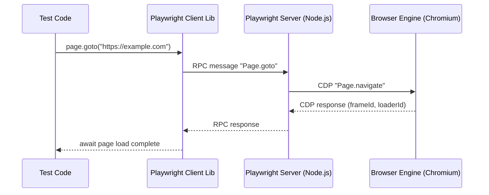
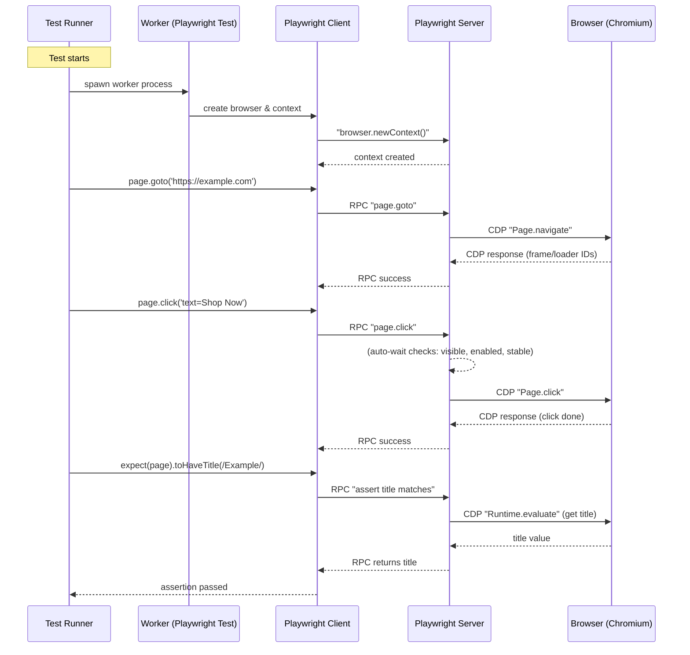

# Playwright Architecture Guide

**Executive Summary:** This guide provides an in-depth exploration of **Playwright**, a modern end-to-end browser automation framework. It covers Playwright’s **three-layer architecture** – the client libraries (language bindings), the Playwright server, and the browser engines – and explains how they interact via persistent WebSocket and Chrome DevTools Protocol (CDP) connections. We discuss core components like **browser contexts** (isolated sessions), **pages and frames**, and advanced features such as **tracing** and **network interception**. Through code examples in JavaScript/TypeScript and Python, students will learn key APIs (e.g. launching browsers, creating contexts/pages, locating elements, routing network requests). The guide also includes sequence and flow diagrams (using Mermaid) to illustrate component interactions, and compares Playwright to Selenium and Puppeteer on attributes like architecture, protocol, and cross-browser support. Finally, we highlight common pitfalls (e.g. flaky tests from fixed waits) and debugging tips (using the inspector, trace viewer, logs, and screenshots). 

**Learning Objectives:** After this guide, students will be able to:
- **Explain Playwright’s client–server–browser architecture.** Understand how Playwright’s single API drives Chromium, Firefox, and WebKit via a Playwright server and CDP.
- **Differentiate Playwright from Selenium and Puppeteer.** Compare protocols (WebSocket+CDP vs HTTP/WebDriver vs in-browser execution) and multi-engine support.
- **Use Playwright APIs for multi-browser automation.** Write code to launch browsers, create isolated contexts/pages, and perform actions on elements in JS/TS and Python.
- **Master selectors and locators.** Employ robust locator strategies (`getByRole`, `getByLabel`, etc.) that benefit from auto-waiting and retry.
- **Utilize browser contexts, pages, and frames.** Create multiple independent sessions for parallel and isolated testing.
- **Implement tracing and network mocking.** Record execution traces (screenshots/snapshots) and intercept or mock network requests.
- **Debug effectively.** Use Playwright’s debugging tools: the Inspector (`--debug` or `page.pause()`), Trace Viewer, and console/DOM inspection.
- **Avoid common mistakes.** Recognize pitfalls like using hard-coded delays and not cleaning up contexts, and follow best practices for stable tests.

**Prerequisites:** This guide assumes familiarity with programming concepts, especially asynchronous code, and basic web development (HTML/CSS/DOM, HTTP). Intermediate knowledge of JavaScript/TypeScript and Python is expected (examples will be in these languages). Some prior exposure to web automation or testing (e.g. using Selenium) is helpful but not required.

## Lesson Plan (approximate durations)
1. **Introduction & Setup (15 min):** Overview of Playwright (history, goals) and installing/initializing a project. *(Cite Playwright’s promise for reliable cross-browser testing.)*
2. **Architecture Layers (30 min):** Explore the 3-tier architecture: *client libraries*, *Playwright server*, *browser engines*. Diagram the flow of a command (page.click) through layers.
3. **Browser Engines & Protocols (20 min):** Explain Chromium/Firefox/WebKit support and how Playwright patches them for CDP. Compare persistent WebSocket (Playwright) vs HTTP (Selenium).
4. **Contexts, Pages & Frames (30 min):** Detail `BrowserContext`, `Page`, and `Frame`. Show how contexts isolate sessions (like incognito). Sequence diagram: creating contexts and opening pages.
5. **Selectors and Locators (20 min):** Cover Playwright’s selector engine (`getByRole`, CSS, text, test-id) and locator API with auto-wait. Code examples for robust element selection.
6. **Tracing & Video (20 min):** Demonstrate tracing (`context.tracing.start/stop`) and using Trace Viewer. Show how to record videos/screenshots on failure.
7. **Network Interception (25 min):** Teach `page.route` and `browserContext.route` for mocking or aborting requests. Example: block images/CSS or mock API responses. Mention HAR recording.
8. **Debugging Techniques (25 min):** Discuss running in debug mode (`--debug`), using `page.pause()`, the Inspector tools, and developer console (`PWDEBUG=console`). Emphasize Playwright’s actionability logs and error screens.
9. **Playwright vs Selenium vs Puppeteer (15 min):** Compare via table: architecture, protocol, languages, browser support, test isolation, etc. *(E.g. Playwright: Client→Server→Browser, WebSocket+CDP; Selenium: WebDriver HTTP; Puppeteer: Headless Chrome/Chromium.)*
10. **Common Pitfalls & Best Practices (20 min):** Highlight flakiness causes and tips (avoid manual waits, isolate tests). Debugging tips recap.
11. **Exercises & Assessment (20 min):** Hands-on tasks (see questions below). Group discussion of answers.

## Playwright Architecture Components

### Browser Engines (Chromium, Firefox, WebKit)
Playwright includes **actual browser binaries** – not just wrappers – for **Chromium** (Chrome/Edge), **Firefox**, and **WebKit** (Safari). Importantly, Microsoft’s Playwright team **patches Firefox and WebKit** to support the Chrome DevTools Protocol (CDP), enabling a unified protocol layer. This contrasts with Selenium, which relies on each browser’s WebDriver (managed by vendors). Because Playwright controls the protocol layer directly, features work consistently across all engines. Each engine runs in its own process (e.g., Chromium has a browser process plus per-tab renderers).

<div class="mermaid">
graph TB
    A[Test Code (page.click())] --> B[Playwright Server]
    B --> C{Choose Engine}
    C --> D[Chromium/CDP]
    C --> E[Firefox/CDP (patched)]
    C --> F[WebKit/CDP (patched)]
    D --> G[Chromium Browser Process]
    E --> H[Firefox Browser Process]
    F --> I[WebKit Browser Process]
    G --> A
    H --> A
    I --> A
</div>

### Playwright Client (Language Bindings)
This is the **library layer** you write code against (e.g. calling `page.goto()`, `page.click()`). Playwright offers bindings for **JavaScript/TypeScript (Node.js)**, **Python**, **Java**, and **.NET (C#)**. Under the hood, each binding serializes your commands into protocol messages. For the JS client, these messages are sent **in-process** to the server. For Python/Java/.NET, Playwright actually spawns a **separate Node.js server process** that the language binding communicates with via a WebSocket. (This is why even Python tests require Node.js: the server runs in Node.) The client layer makes it easy to write cross-browser scripts; you simply `import playwright` and use the same API for all engines.

**Example (JavaScript):**

```javascript
const { chromium, firefox, webkit } = require('playwright');

(async () => {
  // Launch different browsers
  const browser1 = await chromium.launch();
  const browser2 = await firefox.launch();
  const browser3 = await webkit.launch();

  // New page in Chromium
  const context = await browser1.newContext();
  const page = await context.newPage();
  await page.goto('https://example.com');
  console.log(await page.title());

  await browser1.close();
  await browser2.close();
  await browser3.close();
})();
```

**Example (Python):**

```python
from playwright.sync_api import sync_playwright

with sync_playwright() as p:
    browser = p.webkit.launch()
    context = browser.new_context()
    page = context.new_page()
    page.goto("https://example.com")
    print(page.title())
    browser.close()
```

### Playwright Server (Core)
Between your test code and the browser runs the **Playwright Server** (sometimes called the core engine). This separate process is the “brain” that translates high-level API calls into low-level browser protocol commands. It also implements Playwright’s **auto-waiting and actionability checks**: before performing an action (like `click()`), the server ensures the element is visible, stable (not animating), enabled, and not obscured. This built-in waiting makes tests more reliable. The server also **maintains persistent WebSocket connections** to the browser (one per context or browser instance). Instead of opening a new HTTP request per command (like Selenium does), Playwright keeps the socket open and streams JSON messages back and forth. This reduces overhead and enables the server to *push* events (like console logs or network events) to the client in real time. For example, a call to `page.goto(url)` is sent to the server, which turns it into a CDP `Page.navigate` command over WebSocket.

### Communication Protocol: CDP over WebSocket
Playwright’s communication is **bidirectional and event-driven**. The transport layer is WebSocket (persistent connection). On top of that, Playwright speaks **Chrome DevTools Protocol (CDP)** commands natively. For Chromium, CDP is built-in; for Firefox and WebKit, Playwright injected a CDP-compatible layer via patches. Thus all three engines understand the same commands. An example sequence:
1. Client calls `page.goto(url)`.
2. Server converts it to a CDP message like `{ method: "Page.navigate", params: { url } }` and sends over WebSocket.
3. The browser engine processes the command, loads the page, and returns a response (with `frameId`, `loaderId`).
4. The server forwards results/events back to the client. 



In contrast, **Selenium WebDriver** uses HTTP calls for each command (high latency), and **Cypress** runs its code inside the browser (in-process). By keeping a WebSocket “pipe” open, Playwright executes commands with low overhead.

### Browser Contexts: Isolation
A **BrowserContext** is like an isolated profile or incognito session within a single browser instance. Each context has its own cookies, local storage, and permissions, and pages in different contexts cannot see each other’s state. This enables running tests **in parallel without shared state**. Typically, a test runner will create one browser context per test worker. Creating a new context (via `browser.newContext()`) is much faster than launching an entire browser, so Playwright can spin up many isolated contexts quickly. Example:

```javascript
const browser = await chromium.launch();
const context1 = await browser.newContext(); // user A
const context2 = await browser.newContext(); // user B
const pageA = await context1.newPage();
const pageB = await context2.newPage();
await pageA.goto('https://example.com');
await pageB.goto('https://example.com');
// pageA and pageB have separate cookies/storage
await browser.close();
```

Non-persistent contexts (default) do not write data to disk. You can also create persistent contexts (profile folders) if needed, but isolation is the key: Playwright Test Runner automatically gives each test a fresh context to avoid cross-test contamination.

### Pages and Frames
A **Page** represents a single tab or window within a browser context. You create pages via `await context.newPage()`, and most interactions (clicking, typing, etc.) happen on a Page. Each Page has exactly one **main frame** (the top-level browsing context) and may have zero or more child frames (if the page includes `<iframe>` elements). You can interact with frames explicitly if needed. For example, to fill a field inside an iframe you can use `frameLocator`:

```javascript
// Assuming page has <iframe class="frame-class"> ... </iframe>
const username = page.frameLocator('.frame-class').getByLabel('User Name');
await username.fill('John');
```

Or get a frame by name/URL:

```javascript
const frame = page.frame('loginFrame'); // by name
await frame.fill('#username', 'John');
```

### Locators and Selectors
Playwright encourages **resilient locators** that mimic how users see the page. Instead of brittle XPaths, use descriptive methods like `getByRole`, `getByLabel`, `getByText`, or attributes like `getByTestId`. For example: `page.getByRole('button', { name: 'Submit' })`. Locators in Playwright automatically **wait** for the element to be ready (visible, stable, enabled) before acting, reducing flakiness. Example:

```javascript
await page.getByRole('button', { name: 'submit' }).click();
```

Behind the scenes, Playwright still uses CSS or XPath under the hood, but the high-level API handles retries and throws a TimeoutError if nothing matches after the deadline. Custom selector engines are also supported (via `selectors.register`) for special cases. 

### Tracing and Screenshots
Playwright has built-in **tracing** which records all browser actions, DOM snapshots, network requests, and screenshots. This is invaluable for debugging. To use it, start tracing on the context, run actions, then stop and save:

```javascript
await context.tracing.start({ screenshots: true, snapshots: true });
// actions
await page.goto('https://playwright.dev');
await page.getByText('Get Started').click();
await context.tracing.stop({ path: 'trace.zip' });
```

This generates a `trace.zip`. You can view it with Playwright’s **Trace Viewer** (a GUI) to step through each action. The Trace Viewer shows the DOM and events at each step, along with console logs and network requests. Playwright also automatically captures screenshots on test failures (when using Playwright Test) and can record videos of runs by enabling `video: 'on'` in context options.

### Network Interception and Mocking
Playwright provides APIs to **monitor and modify network traffic**. You can intercept requests using `page.route()` (single page) or `context.route()` (all pages in context). For example, to block CSS files:

```javascript
await context.route(/\.css$/, route => route.abort());
await page.goto('https://playwright.dev');
```

Or block images on a specific page:

```javascript
await page.route(/(png|jpeg)$/, route => route.abort());
await page.goto('https://playwright.dev');
```

Routes can also **fulfill** with custom responses (mock APIs) or rewrite request headers. This is useful for offline testing or forcing certain data. Additionally, Playwright supports recording **HAR files** of network activity via `context.tracing.startHar('path.har')`. 

## Component Interaction Diagrams

### Sequence: Page Navigation and Click


### Flowchart: Actionability Checks
```mermaid
flowchart LR
    A[page.click(selector)] --> B{Is element actionable?}
    B -->|Yes| C[Proceed to click via CDP]
    B -->|No| D[Playwright waits/retries]
    D --> B
```
*Flowchart: Playwright’s built-in **actionability checks** automatically verify element state before clicking, preventing interactions with invisible or disabled elements.* 

### Timeline: Playwright Milestones
```mermaid
gantt
    title Playwright Development Timeline
    dateFormat  YYYY-MM-DD
    section Releases
    Playwright 1.0     : milestone, 2020-05-07, 1d    ##
    Python announced  : milestone, 2020-09-30, 1d    ##
    .NET announced     : milestone, 2020-11-25, 1d
    Playwright Test    : milestone, 2021-11-23, 1d
    Trace Viewer (v1.13): milestone, 2022-08-02, 1d    ##
    UI Mode (v1.29)    : milestone, 2023-10-05, 1d    ##
```

## Key Code Examples

Below are illustrative snippets in **JavaScript/TypeScript** and **Python** demonstrating common tasks. (Comments and explanatory text omitted for brevity.)

- **Launching browsers and contexts**:
```javascript
const { chromium, firefox, webkit } = require('playwright');
(async () => {
  const browser = await chromium.launch({ headless: false }); 
  const context = await browser.newContext();
  const page = await context.newPage();
  await page.goto('https://example.com');
  console.log(await page.title());
  await browser.close();
})();
```
```python
from playwright.sync_api import sync_playwright
with sync_playwright() as p:
    browser = p.firefox.launch()    # launch Firefox
    context = browser.new_context() # isolated context
    page = context.new_page()
    page.goto("https://example.com")
    print(page.title())
    browser.close()
```

- **Selectors and locators** (using role/text):
```javascript
await page.fill('input[name="username"]', 'user1');  // CSS selector
await page.getByRole('button', { name: 'Login' }).click();  // role-based locator
await page.getByText('Logout').click();
```
```python
# Using sync API with get_by_role
page.fill('input#search', 'Playwright')
page.click('text=Search')
page.get_by_role("button", name="Submit").click()
```

- **Frames/iframes**:
```javascript
// Access an iframe by its name or URL
const frame = page.frame({ url: /login/ });
await frame.fill('#email', 'test@example.com');
```
```python
frame = page.frame(name="frame-login")
frame.fill("input[type='email']", "test@example.com")
```

- **Tracing**:
```javascript
await context.tracing.start({ screenshots: true, snapshots: true });
await page.goto('https://playwright.dev');
await page.click('text=Get Started');
await context.tracing.stop({ path: 'trace.zip' });
// Now open trace.zip with Playwright Trace Viewer
```

- **Network interception**:
```javascript
// Mock API: return custom JSON for a specific request
await page.route('**/api/data', route => {
  route.fulfill({
    status: 200,
    contentType: 'application/json',
    body: JSON.stringify({ id: 1, name: 'Test' }),
  });
});
await page.goto('https://example.com');
```
```javascript
// Abort requests for images to speed up tests
await page.route(/\.(png|jpg|jpeg)$/, route => route.abort());
await page.goto('https://example.com');
```

- **Assertion (Playwright Test)**:
```typescript
import { test, expect } from '@playwright/test';
test('homepage title', async ({ page }) => {
  await page.goto('https://example.com');
  await expect(page).toHaveTitle(/Example/);
});
```
```python
def test_title(py_page):
    page = py_page
    page.goto("https://example.com")
    assert "Example Domain" in page.title()
```

## Common Pitfalls and Debugging Tips

- **Over-relying on fixed waits** – Using `page.waitForTimeout(…)` or static sleep is brittle. Playwright’s philosophy is **auto-waiting**. Avoid manual sleeps; instead trust locators’ built-in waits and explicit wait conditions (e.g. `await page.waitForURL(...)`). Hard-coded timeouts often cause flaky tests.

- **Not isolating tests** – Each test should use a fresh context. Sharing state (cookies/localStorage) leads to nondeterminism. Use fixtures or beforeEach hooks to create new contexts/pages per test. Use `storageState` to reuse authentication state only when needed.

- **Brittle selectors** – Don’t depend on implementation details (deep CSS or XPath) that may change. Prefer user-focused selectors: roles, labels, `data-testid` attributes. Locator chaining helps narrow scope. For example, `page.getByRole('button', { name: 'Submit' })` is more robust than `page.locator('button.submit-btn')`.

- **Ignoring errors** – Catch unexpected exceptions to avoid killing the test run. Common exceptions include `TimeoutError` on missing elements (playwright.errors.TimeoutError). Use try/catch in tasks where failure is expected, and always close browsers/contexts in `finally` to avoid resource leaks.

- **Overloading workers** – While Playwright Test can run many workers in parallel, too many (beyond CPU cores) can cause resource contention and timeouts. A good rule is ~1-4 workers per machine core.

**Debugging Tips:** Playwright has rich built-in tooling:

- **Playwright Inspector (`--debug`)** – Run `npx playwright test --debug` to launch tests with the Inspector GUI. This pauses between actions and highlights steps in the code and page. You can step through actions and live-edit locators.

- **`page.pause()`** – In code, insert `await page.pause()` to break into Inspector at a specific point. You can then resume execution step-by-step.

- **Trace Viewer** – After recording a trace (`context.tracing`), open it with the Trace Viewer to replay the test flow. You can see DOM snapshots, screenshots, console logs, and network requests per step.

- **Console logs** – In debug mode (`PWDEBUG=console`), Playwright injects a `playwright` object into the browser devtools console. You can inspect the DOM, query elements, and view logs. Standard `console.log()` statements in your test will appear in real time.

- **Screenshots & videos** – Configure Playwright Test to take screenshots (`screenshot: 'only-on-failure'`) and videos (`video: 'on'`) of failing tests. These artifacts, along with the trace, often pinpoint issues.

- **Review actionability logs** – When paused at a click, check the “action log” in Inspector to see why Playwright waited on an element (e.g. not visible or disabled). This helps diagnose flaky actions.

## Playwright vs Selenium vs Puppeteer

| Attribute                  | Playwright                                       | Selenium                            | Puppeteer                                    |
|----------------------------|--------------------------------------------------|-------------------------------------|----------------------------------------------|
| **Architecture Model**     | Client → Server → Browser (out-of-process) | Client → WebDriver → Browser (out-of-process) | In-browser (runs scripts inside browser)      |
| **Communication Protocol** | Persistent WebSocket + CDP        | HTTP+WebDriver (round-trip per command)     | CDP over WebSocket (Chrome/Chromium only)    |
| **Language Support**       | JS/TS, Python, .NET, Java                        | Multiple (Java, Python, C#, Ruby, JS, etc.)  | JavaScript/TypeScript (Node.js)              |
| **Browser Engines**        | Chromium, Firefox, WebKit (native support) | All major browsers (via drivers)     | Chromium (primary), Firefox (experimental)    |
| **Test Isolation**         | BrowserContext isolation for parallel tests | Isolates via new sessions/profiles       | Usually single session (incognito possible)   |
| **Auto-waiting**           | Built-in (waits for element readiness) | Manual waits needed often              | Manual waits (like Selenium)                  |
| **Selectors**              | Rich locators (roles, text, test-id) with retries | Basic CSS/XPath                         | Basic CSS/XPath                               |
| **Tracing & Debugging**    | Built-in trace viewer, Inspector, screenshots | Limited (third-party tools)             | No official trace viewer; uses DevTools       |
| **Parallel Execution**     | True parallel via multiple contexts/workers | Parallel via Selenium Grid/remote servers | Separate processes needed for parallel runs   |
| **CI Support**             | GitHub Action, others (official support)         | Widely supported                       | Community scripts                              |

## Exercises and Assessment

1. **Exercise:** Write code (JS or Python) to launch a Chromium browser, open two new contexts, navigate each to a different URL, and then close the browsers.
   - **Answer:** 
     ```javascript
     const { chromium } = require('playwright');
     (async () => {
       const browser = await chromium.launch();
       const context1 = await browser.newContext();
       const context2 = await browser.newContext();
       const page1 = await context1.newPage();
       const page2 = await context2.newPage();
       await page1.goto('https://example.com');
       await page2.goto('https://playwright.dev');
       await browser.close();
     })();
     ```
     (Python similarly with `p.chromium.launch()`, `new_context()`, etc.)

2. **Exercise:** How do you intercept and mock a network request to `GET /api/users` returning `{users: []}`?
   - **Answer (JS):** 
     ```javascript
     await page.route('**/api/users', route => {
       route.fulfill({
         contentType: 'application/json',
         status: 200,
         body: JSON.stringify({ users: [] }),
       });
     });
     ```

3. **Exercise:** In a test, clicking a button immediately throws a timeout error. What Playwright mechanism might be causing a delay, and how can you investigate it?
   - **Answer:** Playwright performs **actionability checks** before clicking (ensuring visibility, stability, etc.). A button might be hidden or disabled. To debug, use the Inspector or action log (`page.pause()`) to see which check is pending. Also check that locator is correct (use live-edit in Inspector).

4. **Exercise:** Describe the difference between a browser context and a new browser instance in Playwright. Why prefer multiple contexts?
   - **Answer:** A **BrowserContext** is an isolated session within the same browser process (like incognito), whereas launching a new browser instance is heavier (spawns a new process). Multiple contexts are preferred for speed and resource efficiency: they allow parallel independent tests without multiple browser processes.

5. **Assessment:** Compare the command flow of `page.goto()` in Playwright versus Selenium.
   - **Answer:** In Playwright, `page.goto()` is sent as a message to the Playwright server, which issues a CDP `Page.navigate` over a persistent WebSocket to the browser. The browser responds back over WebSocket with a JSON result, and Playwright fulfills the promise. In Selenium, `driver.get()` results in an HTTP POST to the WebDriver endpoint, which in turn communicates with the browser’s WebDriver (often via WebSocket under the hood, but behind an HTTP API). Each Selenium command incurs a full HTTP round-trip, whereas Playwright’s is a lightweight WebSocket message.

## Resources

- **Official Playwright Documentation:** Comprehensive guides and API reference on [playwright.dev](https://playwright.dev) (e.g. [BrowserContext](https://playwright.dev/docs/api/class-browsercontext), [Network](https://playwright.dev/docs/network), [Tracing](https://playwright.dev/docs/api/class-tracing)).
- **Playwright GitHub Repository:** [microsoft/playwright](https://github.com/microsoft/playwright) – source code, releases, and issue tracker.
- **Microsoft Blogs:** Arjun Attam’s announcements:
  - *“Fast and reliable cross-browser testing with Playwright”* (2020) (introduces Playwright 1.0).
  - *“Announcing Playwright for Python”* (2020) (introduces Python support).
- **InfoQ News:** *“Microsoft Announces Playwright…”* (overview of Playwright features and goals).
- **Technical Articles:** 
  - TestDino’s *“Playwright Architecture: Complete Visual Guide (2026)”* (in-depth architecture walkthrough).
  - Official blog posts on [Playwright.dev Blog](https://playwright.dev/blog) (feature updates).
  - [W3C WebDriver Specification](https://www.w3.org/TR/webdriver/) – for understanding standard WebDriver (Selenium).
- **Community Resources:** GitHub issues, StackOverflow, and Playwright Discord for Q&A; relevant chapters in testing books like *“Frontend Web Developer’s Guide to Testing”*.

---

<!-- HTML File Content Below -->

```html
<!DOCTYPE html>
<html lang="en">
<head>
<meta charset="UTF-8">
<title>Playwright Architecture Guide</title>
<style>
body { font-family: Arial, sans-serif; line-height: 1.6; margin: 2em; }
h1, h2, h3, h4 { color: #333; }
h1 { text-align: center; }
table { border-collapse: collapse; width: 100%; margin-bottom: 1.5em; }
th, td { border: 1px solid #ccc; padding: 0.5em; text-align: left; }
code { background: #f9f9f9; padding: 2px 4px; border-radius: 4px; }
pre { background: #f4f4f4; padding: 1em; overflow: auto; }
.flowchart, .mermaid { text-align: center; margin: 1em 0; }
.timeline { text-align: center; margin: 1em 0; }
</style>
<!-- Include Mermaid for diagrams -->
<script src="https://cdn.jsdelivr.net/npm/mermaid/dist/mermaid.min.js"></script>
<script>mermaid.initialize({ startOnLoad: true });</script>
</head>
<body>
<article>
  <h1>Playwright Architecture Guide</h1>
  <p><strong>Executive Summary:</strong> This guide provides an in-depth exploration of <strong>Playwright</strong>, a modern end-to-end browser automation framework. It covers Playwright’s <strong>three-layer architecture</strong> – the client libraries (language bindings), the Playwright server, and the browser engines – and explains how they interact via persistent WebSocket and Chrome DevTools Protocol (CDP) connections. We discuss core components like <strong>browser contexts</strong> (isolated sessions), <strong>pages and frames</strong>, and advanced features such as <strong>tracing</strong> and <strong>network interception</strong>. Through code examples in JavaScript/TypeScript and Python, students will learn key APIs (e.g. launching browsers, creating contexts/pages, locating elements, routing network requests). The guide also includes sequence and flow diagrams (using Mermaid) to illustrate component interactions, and compares Playwright to Selenium and Puppeteer on attributes like architecture, protocol, and cross-browser support. Finally, we highlight common pitfalls (e.g. flaky tests from fixed waits) and debugging tips (using the inspector, trace viewer, logs, and screenshots).</p>

  <h2>Learning Objectives</h2>
  <ul>
    <li><strong>Explain Playwright’s architecture.</strong> Understand how Playwright’s single API drives Chromium, Firefox, and WebKit via a Playwright server and CDP.</li>
    <li><strong>Differentiate from other tools.</strong> Compare Playwright to Selenium and Puppeteer in terms of protocol, concurrency, and browser support.</li>
    <li><strong>Use Playwright APIs.</strong> Launch browsers, create contexts and pages, and perform actions in JS/TS and Python.</li>
    <li><strong>Master selectors.</strong> Use robust locator strategies (`getByRole`, text, test-id) that benefit from auto-waiting.</li>
    <li><strong>Work with contexts and frames.</strong> Create isolated browser contexts and interact with nested frames/iframes.</li>
    <li><strong>Implement tracing and network mocks.</strong> Record execution traces and intercept/mock network requests.</li>
    <li><strong>Debug effectively.</strong> Utilize Playwright’s tools: Inspector (`--debug`), Trace Viewer, screenshots, etc.</li>
    <li><strong>Avoid pitfalls.</strong> Learn best practices to prevent flakiness (e.g. no hard sleeps, clean state per test).</li>
  </ul>

  <h2>Prerequisite Knowledge</h2>
  <ul>
    <li>Intermediate programming (JavaScript/TypeScript, Python).</li>
    <li>Basic web development (HTML, CSS, DOM) and HTTP concepts.</li>
    <li>Familiarity with asynchronous code (Promises, async/await).</li>
    <li>Some experience with testing or automation (beneficial but not strictly required).</li>
  </ul>

  <h2>Lesson Plan (approximate durations)</h2>
  <ol>
    <li><strong>Introduction & Setup</strong> (15 min): Overview of Playwright (history, goals) and installing/initializing a project.</li>
    <li><strong>Architecture Layers</strong> (30 min): Explore the 3-tier architecture: <em>client libraries</em>, <em>Playwright server</em>, <em>browser engines</em>. Diagram the flow of a command (e.g. <code>page.click()</code>).</li>
    <li><strong>Browser Engines & Protocols</strong> (20 min): Explain Chromium/Firefox/WebKit support and how Playwright patches them for CDP. Compare persistent WebSocket (Playwright) vs HTTP (Selenium).</li>
    <li><strong>Contexts, Pages & Frames</strong> (30 min): Detail <code>BrowserContext</code>, <code>Page</code>, and <code>Frame</code>. Show how contexts isolate sessions (like incognito). Sequence diagram: creating contexts and pages.</li>
    <li><strong>Selectors and Locators</strong> (20 min): Cover Playwright’s selector engine (<code>getByRole</code>, CSS, text, test-id) and locator API with auto-wait. Code examples for element selection.</li>
    <li><strong>Tracing & Video</strong> (20 min): Demonstrate tracing (<code>context.tracing.start/stop</code>) and using Trace Viewer. Show how to record videos/screenshots on failure.</li>
    <li><strong>Network Interception</strong> (25 min): Teach <code>page.route()</code> and <code>browserContext.route()</code> for mocking or aborting requests. Example: block images/CSS or mock API responses.</li>
    <li><strong>Debugging Techniques</strong> (25 min): Discuss running in debug mode (<code>--debug</code>), using <code>page.pause()</code>, the Inspector tools, and developer console (<code>PWDEBUG=console</code>). Emphasize actionability logs and error screens.</li>
    <li><strong>Playwright vs Selenium vs Puppeteer</strong> (15 min): Compare via table: architecture, protocol, languages, browser support, test isolation, etc.</li>
    <li><strong>Common Pitfalls & Best Practices</strong> (20 min): Highlight flakiness causes and tips (avoid manual waits, isolate tests). Debugging tips recap.</li>
    <li><strong>Exercises & Assessment</strong> (20 min): Hands-on tasks (see below). Group discussion of answers.</li>
  </ol>

  <h2>Architecture Components</h2>
  <h3>Browser Engines (Chromium, Firefox, WebKit)</h3>
  <p>Playwright includes <em>actual browser binaries</em> – not just wrappers – for <strong>Chromium</strong> (Chrome/Edge), <strong>Firefox</strong>, and <strong>WebKit</strong> (Safari). Importantly, Microsoft’s Playwright team <strong>patches Firefox and WebKit</strong> to support the Chrome DevTools Protocol (CDP), enabling a unified control layer. This contrasts with Selenium, which relies on each browser’s own WebDriver. Because Playwright controls the protocol layer directly, features work consistently across all engines. Each engine runs in its own process (e.g., Chromium has a browser process plus per-tab renderers). For example, a click on a page goes: <code>Test Code → Playwright Server → Browser Engine</code>, with messages flowing back and forth over WebSocket.</p>

  <h3>Playwright Client (Language Bindings)</h3>
  <p>This layer is the API you write tests with (e.g. <code>page.click()</code>, <code>expect()</code>). Playwright offers bindings for <strong>JavaScript/TypeScript</strong> (Node.js), <strong>Python</strong>, <strong>Java</strong>, and <strong>.NET (C#)</strong>. Each binding serializes your commands into protocol messages that the server understands. By default, the JS client talks to the server in-process, while the Python/Java/.NET clients spawn a separate Node.js process and use WebSocket. (Hence Node.js is required even for Python tests.) The client layer abstracts away engine differences, so you use the same API for all browsers.</p>

  <h3>Playwright Server (Core Engine)</h3>
  <p>The Playwright Server (a Node.js process) sits between your code and the browser, handling:</p>
  <ul>
    <li><strong>Command translation:</strong> Converts high-level calls (like <code>page.click()</code>) into CDP commands.</li>
    <li><strong>Auto-waiting:</strong> Performs actionability checks (element visible, stable, enabled, not obscured) before executing actions.</li>
    <li><strong>Event routing:</strong> Streams browser events (console logs, network requests, page load) back to your test.</li>
    <li><strong>Connection management:</strong> Maintains persistent WebSocket connections to browser instances.</li>
  </ul>
  <p>This design gives Playwright a speed advantage. Instead of separate HTTP round-trips per action (as in Selenium), the server keeps a continuous “conversation” with the browser. For example, when you call <code>page.goto(url)</code>, the client sends a single message to the server, which issues a CDP <code>Page.navigate</code> over the WebSocket. The browser responds with navigation events, which the server forwards back to the client. Throughout this process, the server’s auto-wait logic ensures reliability.</p>

  <h3>Communication Protocols: WebSocket & CDP</h3>
  <p>Playwright uses a persistent <strong>WebSocket</strong> connection for messaging. This means after the initial handshake, commands and events flow bidirectionally without reconnecting. A simple benchmark: with WebSocket, sending 50 sequential commands can save ~100–200ms compared to HTTP-based tools (eliminating TCP and HTTP overhead). Underlying those messages is the <strong>Chrome DevTools Protocol (CDP)</strong>. Chromium speaks CDP natively; for Firefox and WebKit, Playwright injects CDP compatibility. The messages look like JSON: e.g., 
  <pre><code>{
  "id": 1,
  "method": "Page.navigate",
  "params": { "url": "https://example.com" }
}</code></pre>
  The browser replies with a matching <code>id</code> and result. Playwright even exposes a raw <code>CDPSession</code> API for low-level control. This architecture (WebSocket+CDP) makes Playwright fast and cross-browser consistent.</p>

  <h3>Browser Contexts: Isolation & Parallelism</h3>
  <p>A <code>BrowserContext</code> is an isolated session (like an incognito profile). Each context has its own cookies, cache, storage, and permissions. Contexts allow tests to run in parallel **without shared state**. For instance, two contexts can log in as different users on the same site in the same browser process. This saves resources and speeds up tests compared to launching multiple browser instances. Best practice: use one context per test (Playwright Test does this by default). The API is simply:
  <pre><code>const context = await browser.newContext();
// use context.newPage() for tabs
await context.newPage();</code></pre>
  Non-persistent contexts (default) do not write data to disk. You can optionally create a persistent context with `browserType.launchPersistentContext`, which uses a real user profile folder (useful for login caching, etc.).</p>

  <h3>Page and Frames</h3>
  <p>A <code>Page</code> is a single tab/window in a context. You create it with <code>context.newPage()</code>. All interactions (click, type, navigate) happen on a Page. Each Page has exactly one <em>main frame</em> (the top-level DOM). If the page contains iframes (`<iframe>`), those are additional <code>Frame</code> objects attached to the Page. Page-level actions (e.g., <code>page.click()</code>) target the main frame by default. You can also locate or work with elements inside a frame. For example:
  <pre><code>// Locating inside an iframe
const frameLocator = page.frameLocator('#login-frame');
await frameLocator.getByLabel('Username').fill('user1');</code></pre>
  Or get a frame by name or URL:
  <pre><code>const frame = page.frame('frame-name'); // or frame({ url: /login/ })
await frame.fill('#password', 'secret');</code></pre>
  Handling frames is automatic: Playwright waits for frames to load before interacting. Use <code>page.frame()</code> or <code>page.frameLocator()</code> for precise control.</p>

  <h3>Locators and Selectors</h3>
  <p>Playwright’s **Locator** API provides rich selectors and auto-waiting. Instead of brittle CSS/XPath, use user-centric locators. For example:
  <ul>
    <li><code>page.getByRole('button', { name: 'Submit' })</code></li>
    <li><code>page.getByLabel('Email').fill('test@example.com')</code></li>
    <li><code>page.getByText('Next Page').click()</code></li>
    <li><code>page.locator('data-testid=my-button')</code> (using data-test-id attribute)</li>
  </ul>
  Locators automatically wait for elements to be visible and enabled before performing actions. This eliminates most timing issues. You can chain locators to narrow context:
  <pre><code>await page.locator('form').getByRole('button', { name: 'Save' }).click();</code></pre>
  Playwright also supports custom selector engines (`selectors.register`) for advanced cases. **Avoid** long fragile selectors (like deep CSS paths); instead rely on stable, user-facing attributes or roles.</p>

  <h3>Tracing and Videos</h3>
  <p>Playwright has built-in tracing to record a test’s execution. It captures DOM snapshots, screenshots, and network calls. Example usage:
  <pre><code>await context.tracing.start({ screenshots: true, snapshots: true });
await page.goto('https://playwright.dev');
await page.click('text="Get Started"');
await context.tracing.stop({ path: 'trace.zip' });</code></pre>
  After the test, open <code>trace.zip</code> in the Playwright Trace Viewer to step through every action. The trace shows the state of the page at each step, console logs, and details of actions. This is invaluable for debugging complex flows. Playwright Test can also capture **videos** of test runs by setting <code>video: 'on'</code> in the context options. Combined with **screenshots on failure** and the Trace Viewer, you have a complete debugging toolkit.</p>

  <h3>Network Interception</h3>
  <p>Playwright can monitor and modify network traffic for a page or context. Common APIs:
  <ul>
    <li><code>context.route(pattern, handler)</code> – intercepts requests matching a pattern. E.g. block CSS or images:
      <pre><code>await context.route(/\.css$/, route => route.abort());</code></pre>
    </li>
    <li><code>page.route(pattern, handler)</code> – intercepts for a single page.
    </li>
    <li><code>route.fulfill</code> – mock responses with custom status/body.
    </li>
  </ul>
  Example: mock an API endpoint:
  <pre><code>await page.route('**/api/users', route => {
  route.fulfill({
    status: 200,
    contentType: 'application/json',
    body: JSON.stringify({ users: [] }),
  });
});
await page.goto('https://example.com');</code></pre>
  You can also block third-party trackers, throttle networks, or use <code>context.tracing.startHar('network.har')</code> to record a HAR file of network activity. These features help write fast, reliable tests by eliminating flaky external dependencies.</p>

  <h2>Component Interaction Diagrams</h2>
  <h3>Sequence: Page Navigation and Click</h3>
  <div class="mermaid">
sequenceDiagram
    participant T as Test Runner
    participant W as Worker (Playwright Test)
    participant C as Playwright Client
    participant S as Playwright Server
    participant B as Browser (Chromium)

    Note over T: Test starts
    T->>W: Spawn worker process
    W->>C: Initialize Browser & Context
    C->>S: "browser.newContext()"
    S-->>C: Context created

    T->>C: page.goto('https://example.com')
    C->>S: RPC "page.goto"
    S->>B: CDP "Page.navigate"
    B-->>S: CDP response (loaderId, frameId)
    S-->>C: RPC success
    C-->>T: page loaded

    T->>C: page.click('text=Shop Now')
    C->>S: RPC "page.click"
    S-->>S: Auto-wait checks (visibility, etc.)
    S->>B: CDP "Page.click"
    B-->>S: CDP response (click done)
    S-->>C: RPC success

    T->>C: expect(page).toHaveTitle(/Example/)
    C->>S: RPC "toHaveTitle"
    S->>B: CDP "Runtime.evaluate" (get title)
    B-->>S: title value
    S-->>C: RPC returns title
    C-->>T: Assertion passed
  </div>

  <h3>Flowchart: Element Actionability</h3>
  <div class="mermaid">
flowchart LR
    A[page.click(selector)] --> B{Is element actionable?}
    B -->|Yes| C[Send CDP click command]
    B -->|No| D[Playwright auto-waits and retries]
    D --> B
  </div>

  <h3>Timeline: Playwright Milestones</h3>
  <div class="mermaid">
gantt
    title Playwright Development Timeline
    dateFormat  YYYY-MM-DD
    section Key Releases
    Playwright 1.0     : milestone, 2020-05-07, 1d
    Python support     : milestone, 2020-09-30, 1d
    Playwright for .NET: milestone, 2020-11-25, 1d
    Test Runner v1.0   : milestone, 2021-11-23, 1d
    Trace Viewer (v1.13): milestone, 2022-08-02, 1d
    UI Mode (v1.29)    : milestone, 2023-10-05, 1d
  </div>

  <h2>Code Examples</h2>
  <p>Some illustrative examples in JavaScript/TypeScript and Python:</p>
  <h3>Launching Browsers and Contexts</h3>
  <pre><code class="language-js">// JavaScript/TypeScript example
const { chromium, firefox, webkit } = require('playwright');
(async () => {
  const browser = await chromium.launch({ headless: false });
  const context = await browser.newContext();
  const page = await context.newPage();
  await page.goto('https://example.com');
  console.log(await page.title());
  await browser.close();
})();</code></pre>

  <pre><code class="language-python"># Python example
from playwright.sync_api import sync_playwright
with sync_playwright() as p:
    browser = p.firefox.launch()
    context = browser.new_context()
    page = context.new_page()
    page.goto("https://example.com")
    print(page.title())
    browser.close()</code></pre>

  <h3>Locators and Selectors</h3>
  <pre><code class="language-js">// JavaScript locators
await page.fill('input[name="username"]', 'user1');  // CSS selector
await page.getByRole('button', { name: 'Submit' }).click();  // accessible role-based
await page.getByText('Logout').click();</code></pre>

  <pre><code class="language-python"># Python locators
page.fill('input#search', 'Playwright')
page.click('text=Search')
page.get_by_role("button", name="Submit").click()</code></pre>

  <h3>Frames/Iframes</h3>
  <pre><code class="language-js">// JavaScript frame example
const frame = page.frame({ url: /login/ });
await frame.fill('#email', 'test@example.com');</code></pre>

  <pre><code class="language-python"># Python frame example
frame = page.frame(name="frame-login")
frame.fill("input[type='email']", "test@example.com")</code></pre>

  <h3>Tracing</h3>
  <pre><code class="language-js">// JavaScript tracing example
await context.tracing.start({ screenshots: true, snapshots: true });
await page.goto('https://playwright.dev');
await page.click('text="Get Started"');
await context.tracing.stop({ path: 'trace.zip' });</code></pre>

  <h3>Network Interception</h3>
  <pre><code class="language-js">// Block images example
await page.route(/\.(png|jpg|jpeg)$/, route => route.abort());
await page.goto('https://example.com');</code></pre>

  <pre><code class="language-js">// Mock API example
await page.route('**/api/data', route => {
  route.fulfill({
    status: 200,
    contentType: 'application/json',
    body: JSON.stringify({ id: 1, name: 'Test' }),
  });
});
await page.goto('https://example.com');</code></pre>

  <h3>Assertions (Playwright Test)</h3>
  <pre><code class="language-js">import { test, expect } from '@playwright/test';
test('homepage title', async ({ page }) => {
  await page.goto('https://example.com');
  await expect(page).toHaveTitle(/Example/);
});</code></pre>

  <pre><code class="language-python">def test_title(py_page):
    page = py_page
    page.goto("https://example.com")
    assert "Example Domain" in page.title()</code></pre>

  <h2>Common Pitfalls & Debugging</h2>
  <ul>
    <li><strong>Avoid fixed waits:</strong> Using <code>page.waitForTimeout</code> or hard sleeps often makes tests flaky. Rely on Playwright’s auto-waiting instead.</li>
    <li><strong>Isolate tests:</strong> Give each test a fresh context so state (cookies, storage) doesn’t bleed between tests.</li>
    <li><strong>Use stable selectors:</strong> Prefer <code>getByRole</code>, labels, or <code>data-testid</code> over brittle CSS/XPath. Chaining and filtering locators makes them more robust.</li>
    <li><strong>Headless vs headed mode:</strong> For debugging, launch browsers with `headless: false` or use slowMo to observe actions.</li>
    <li><strong>Cleanup:</strong> Always close pages/contexts/browsers in <code>finally</code> to free resources.</li>
  </ul>

  <h3>Debugging Tips</h3>
  <ul>
    <li><strong>Playwright Inspector:</strong> Run tests with <code>npx playwright test --debug</code> to open the Inspector. You can step through actions, see the current step highlighted, and live-edit locators.</li>
    <li><code><strong>page.pause()</strong>:</code> Insert <code>await page.pause()</code> in code to pause execution on that line. The inspector will open at that point.</li>
    <li><strong>Trace Viewer:</strong> Use after recording a trace. Explore the timeline of actions, DOM snapshots, console logs, and network requests.</li>
    <li><strong>DevTools console:</strong> Set <code>PWDEBUG=console</code> before running. A <code>playwright</code> object becomes available in Chrome DevTools. You can inspect elements, run <code>$$('selector')</code>, and see console logs.</li>
    <li><strong>Screenshots/Videos:</strong> Enable screenshot/video capture on failure via config (e.g. <code>use: { screenshot: 'only-on-failure', video: 'on' }</code>) to get visual logs.</li>
    <li><strong>Actionability logs:</strong> In Inspector, review the “action log” for why Playwright waited (was element covered, not visible, etc.).</li>
  </ul>

  <h2>Comparison: Playwright vs Selenium vs Puppeteer</h2>
  <table>
    <thead>
      <tr>
        <th>Attribute</th><th>Playwright</th><th>Selenium</th><th>Puppeteer</th>
      </tr>
    </thead>
    <tbody>
      <tr>
        <td>Architecture Model</td>
        <td>Client→Server→Browser (out-of-process)</td>
        <td>Client→WebDriver→Browser (out-of-process)</td>
        <td>Runs inside browser (in-process)</td>
      </tr>
      <tr>
        <td>Communication</td>
        <td>WebSocket + CDP</td>
        <td>HTTP + WebDriver protocol</td>
        <td>CDP (Chromium only)</td>
      </tr>
      <tr>
        <td>Languages</td>
        <td>JS/TS, Python, Java, .NET</td>
        <td>Java, Python, C#, Ruby, JS, etc.</td>
        <td>JavaScript/TypeScript</td>
      </tr>
      <tr>
        <td>Browser Support</td>
        <td>Chromium, Firefox, WebKit (native)</td>
        <td>All major via drivers</td>
        <td>Chromium/Chrome (primary), Firefox (experimental)</td>
      </tr>
      <tr>
        <td>Test Isolation</td>
        <td>BrowserContext for parallelism</td>
        <td>New profile or WebDriver session</td>
        <td>Separate browser processes</td>
      </tr>
      <tr>
        <td>Auto-wait</td>
        <td>Built-in (no extra waits needed)</td>
        <td>No (requires explicit waits)</td>
        <td>No (similar to Selenium)</td>
      </tr>
      <tr>
        <td>Selectors</td>
        <td>Advanced (roles, text, test-id)</td>
        <td>Basic CSS/XPath</td>
        <td>Basic CSS/XPath</td>
      </tr>
      <tr>
        <td>Tracing/Debugging</td>
        <td>Built-in trace viewer, inspector, screenshots</td>
        <td>Limited (external tools)</td>
        <td>No official trace viewer</td>
      </tr>
      <tr>
        <td>Parallel Execution</td>
        <td>True parallel via multiple contexts/workers</td>
        <td>Selenium Grid for parallel tests</td>
        <td>Custom setup (e.g., cluster of headless browsers)</td>
      </tr>
    </tbody>
  </table>

  <h2>Exercises and Assessment Questions</h2>
  <ol>
    <li><strong>Exercise:</strong> Launch a Chromium browser, open two isolated contexts, navigate each to a different URL, then close the browser.  
      <br><em>Answer:</em> (JS example below)
      <pre><code class="language-js">const { chromium } = require('playwright');
(async () => {
  const browser = await chromium.launch();
  const contextA = await browser.newContext();
  const contextB = await browser.newContext();
  const pageA = await contextA.newPage();
  const pageB = await contextB.newPage();
  await pageA.goto('https://example.com');
  await pageB.goto('https://playwright.dev');
  await browser.close();
})();</code></pre>
    </li>
    <li><strong>Exercise:</strong> Intercept `GET /api/users` and mock it to return `{"users": []}`.  
      <br><em>Answer:</em> 
      <pre><code class="language-js">await page.route('**/api/users', route => {
  route.fulfill({
    status: 200,
    contentType: 'application/json',
    body: JSON.stringify({ users: [] }),
  });
});
await page.goto('https://example.com');</code></pre>
    </li>
    <li><strong>Exercise:</strong> A click action times out. What might be wrong, and how do you debug?  
      <br><em>Answer:</em> Playwright auto-checks element <em>actionability</em>. The element might be invisible, disabled, or detached. To debug, use the Inspector or insert <code>page.pause()</code> to see why Playwright is waiting. Check the action log to see if the element was not visible or overlapped.
    </li>
    <li><strong>Exercise:</strong> Explain browser contexts vs. browser instances. Why use contexts?  
      <br><em>Answer:</em> A context is an isolated session within the same browser process (fast to create). Multiple contexts allow parallel tests with separate state. Launching a new browser is heavier. Contexts are preferred for efficiency and isolation.
    </li>
    <li><strong>Assessment:</strong> Compare the flow of <code>page.goto()</code> in Playwright vs. Selenium.  
      <br><em>Answer:</em> In Playwright, <code>page.goto()</code> sends a message to the Playwright server, which issues a CDP <code>Page.navigate</code> command over WebSocket to the browser. The browser responds back via WebSocket. In Selenium, <code>driver.get()</code> sends an HTTP request to the WebDriver server, which then instructs the browser via WebDriver protocol. Each Selenium command uses a full HTTP request/response cycle, whereas Playwright’s uses a lightweight persistent channel.
    </li>
  </ol>

  <h2>Resources and Further Reading</h2>
  <ul>
    <li><strong>Playwright Documentation (playwright.dev):</strong> Official guides and API reference, including the [BrowserContext API](https://playwright.dev/docs/api/class-browsercontext) and [Network documentation](https://playwright.dev/docs/network).</li>
    <li><strong>GitHub Repository:</strong> <a href="https://github.com/microsoft/playwright">microsoft/playwright</a> – source code and release notes.</li>
    <li><strong>Microsoft DevBlogs:</strong> 
      <ul>
        <li>“<em>Fast and reliable cross-browser testing with Playwright</em>” (May 2020) – announcement of Playwright 1.0.</li>
        <li>“<em>Announcing Playwright for Python</em>” (Sep 2020) – introducing Python support.</li>
      </ul>
    </li>
    <li><strong>InfoQ News:</strong> “<em>Microsoft Announces Playwright: Browser Automation for Chromium, Firefox, WebKit</em>” (Jan 2020).</li>
    <li><strong>TestDino Blog:</strong> “Playwright Architecture: Complete Visual Guide (2026)” – deep architectural dive.</li>
    <li><strong>Community:</strong> Playwright Discord, StackOverflow (<code>#playwright</code>), and tutorials on GitHub and Dev.to.</li>
  </ul>
</article>
</body>
</html>
```